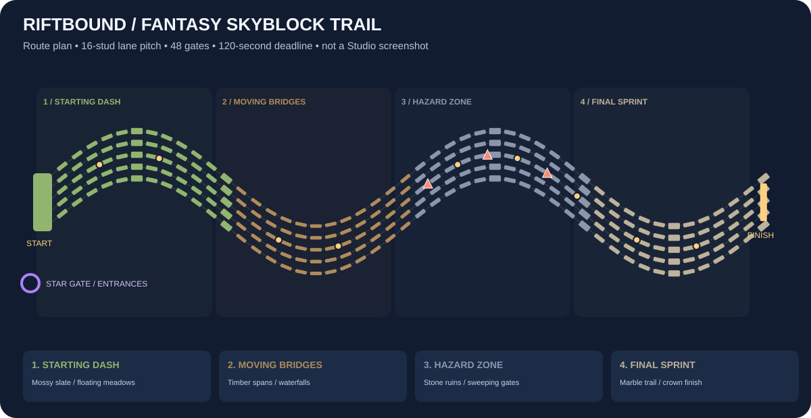

# Riftbound Live — fantasy skyblock race show

An automated physical obstacle race for portrait LIVE capture: five NPC racers,
a 1,281-stud S-shaped route, 48 measured gates, four sections and a 120-second deadline.
Section cameras follow actual competitors, with regular spotlights, finish-line
coverage and winner celebrations. Queued viewer arrivals get a Star Gate montage
while the competition keeps running.



**v9 upgrade from v7/v8: replace World and the client Realm together.** Follow
[the two-file replacement instructions](docs/FANTASY_SKYBLOCK_REPLACEMENT.md).
For older installations, replace all FIVE raw scripts using
[exact replacements and Studio checks](docs/RACE_SHOW_REPLACEMENT.md).
MANUAL_STUDIO_SETUP.md contains every complete source. Keep
Workspace.StreamingEnabled=false for this playtest; the exported place already does.
No Command Bar installer, plugin or Node bridge is required.

| Section | Gates | Main challenge |
| --- | --- | --- |
| Starting Dash | 1–12 | Mossy slate, grassy islands and height changes |
| Moving Bridges | 13–24 | Timber spans, waterfall islands and lane hurdles |
| Hazard Zone | 25–36 | Stone ruins, sweeping magical gates and jumps |
| Final Sprint | 37–48 | Marble trail and dramatic crown arch |

Lanes use 16-stud pitch with checked moving-support envelopes. Floating meadows,
trees, crystals, portals, waterfalls and clouds flank the route. Decorative parts
are non-colliding; Stream can locally hide tagged scenery that obscures racers.

All racers use equal movement settings. The 12-stud/second baseline is about 107
seconds before waits/recovery. Actual roots, grounded checkpoints and a physical
finish-plane crossing determine results; no timer or name determines a winner.
Falls recover only to verified pads and retain the clock. Rewards remain fictional,
server authoritative and in memory: $2/checkpoint, $40 finish and $120/$75/$40 podium
prizes, plus existing passive/vote/activity earnings and caps. Gifts stay cosmetic.

The director fits nearby avatars at medium distance rather than zooming out to the
whole map. It tracks the lead section, periodically shows other competitors, and
uses dedicated finish/podium shots. Safe fallbacks, daylight, opacity restoration
and the working ROAM VIEW / STREAM VIEW controls remain. A named Studio Baseplate
is hidden locally in Stream and restored in Roam for a sky background. Five readable
live-position rows, progress, countdowns and large entrance/winner names support
portrait capture and landscape testing. Client diagnostics identify **race-show-v9**.

**OFFLINE JOIN** creates a local stand-in. **ROBLOX JOIN / VERIFY ACCOUNT** uses a
bounded native username lookup, then optional native avatar appearance APIs.
Normal entrances last four seconds; bursts group three for 2.5 seconds. Entrants
become eligible for the next cohort after presentation. Unraced viewers get priority;
returning racers rotate. Studio Demo_ viewers and gifts/follows remain explicitly
simulated. DataStoreService, custom HTTP and external TikTok integration stay disabled.
For zero authored account/appearance calls, use OFFLINE JOIN and set
ResolveViewerUsernames=false and LoadAvatarAppearances=false.

Validation includes all authored route sections, geometric jump feasibility,
speed-limited navigation commands, measured timing/rewards, queues, account lookup
failures, section/entrance/finish framing, Roam restoration and exact raw/export
source checks. **Cloud mocks do not reproduce native Roblox physics or rendering.**
The 90–120-second finish target still needs real Studio timing and jump/contact
validation. See the [playtest checklist and limits](docs/RACE_SHOW_REPLACEMENT.md).

## Development checks

```sh
npm ci --ignore-scripts
npm test
npm run check:luau
```

The native compiler is installed by the environment setup. The build regenerates
the five-block manual guide, XML place and ZIP. Tests use Node 22+, Fengari and
limited service/geometry mocks; no external integration is started by the game.

## Node simulator and future TikTok integration are separate

The offline game does not need Node. The optional browser control desk runs with:

```sh
cd /workspace/Personal_Project
npm ci --ignore-scripts
npm run dev
```

Node 22+ is required. The simulator binds to loopback port 8787. In local development,
open that port in your browser; the cloud onboarding UI does not provide localhost
previews. The control desk is an illustration and event simulator, not a live 3D view.
The default offline game does **not** poll it: browser events remain pending and
expire after two minutes. The default Studio demo runs automatically; use TEST TOOLS only for targeted tests.

Node event queues and receipts are also memory-only and clear on restart. Legacy
`.local/queue.json` files, if present from earlier versions, are not read or changed.
The ignored `.local/game-config.json` holds a generated transport credential only;
it contains no gameplay state. Never share or commit it. The Node service has
separate admin/game authentication for the later optional transport.

Real TikTok comments, gifts, and follows are **not connected**. No TikTok connector
is installed, imported, started, or contacted. `integrations/README.md` describes
an explicit future setup, with HTTPS hosting, an authorized LIVE connector, stable
viewer IDs, finalized gift events, and separate admin/game credentials. The optional
Roblox HTTP and avatar modules live under `integrations/roblox/`; neither is included
in the five manual game files, the `.rbxlx`, or the default Rojo project.

## Build and validation

```sh
npm ci --ignore-scripts
npm run check
npm run check:luau    # native compiler required; prepared in this cloud workspace
npm run test:browser  # optional browser simulator check; Chromium required
```

Node 22+ and Python 3 are required for development tools, not for manual Studio
setup. The build generates `MANUAL_STUDIO_SETUP.md`, the optional equivalent
`dist/RiftboundLive.rbxlx`, and `dist/RiftboundLive-Starter.zip` containing the five
raw sources with their correct folder structure. It does not generate an installer
or assign Script.Source at runtime. Edit the five source files directly. Studio
edits do not automatically sync back to the repository.

Automated tests exercise the actual pure-Lua rules, economy, voting, leaderboards,
gifts/follows, the optional Node bridge, local module dependencies, remote names,
source-code identity in the manual guide and ZIP, and offline API exclusions.
Phase 2 tests also drive the actual server scheduler with mocked services for
340 simulated seconds, checking that demo arrivals, gifts and several rounds run
without human/host calls. A separate 440-second command-following stub repeats the
actual physical controller/server/client pipeline; it does not simulate native
collision, jumping, rendering or engine physics. The
native Luau compiler validates all five actual game files and all five sources in
the optional XML place. They cannot validate Roblox rendering, physics, or Studio
UI behavior. Run the manual checklist on Windows/macOS.

The prepared compiler is `.local/tools/luau-compile`. To use another official
compiler, set `LUAU_COMPILE` to its path. Source revision and reproduction details
are in `docs/SOURCE_VALIDATION.md`. An optional `default.project.json` is available
for Rojo users, but no plugin is needed for manual setup.
